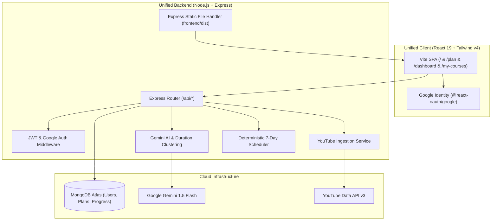

# StudyFlow (BetterCourse): AI-Powered Study Planner for YouTube Playlists

> Paste any YouTube study playlist. Get an AI-clustered topic breakdown, realistic effort estimation, weekly deadlines, user accounts with Google OAuth, and adaptive re-planning.

---

## What's New in the Unified MERN Release (`mern` branch)

1. **Unified Full-Stack Node.js + Express + React Architecture**:
   - Single-domain deployment on Render: Express serves both the `/api/*` REST endpoints and the compiled React SPA.
   - Zero CORS issues and single SSL certificate setup.
2. **Native MongoDB User Accounts**:
   - Secure registration & login with `bcryptjs` password hashing and JWT sessions.
   - No vendor lock-in (no Firebase or Supabase required).
3. **Google OAuth 2.0 (GAuth)**:
   - One-click "Sign in with Google" verified securely via `google-auth-library`.
4. **Persistent Course Library ("My Courses")**:
   - Logged-in users have all their study plans and progress synced across devices.
5. **Guest Mode**:
   - Instant guest access without forced login (plans saved locally until signed in).

---

## System Architecture



---

## Quickstart (Local Development)

### Prerequisites
- Node.js 20+
- npm 10+

### 1. Install Dependencies
```bash
# Install root (backend) dependencies
npm install

# Install frontend dependencies
cd frontend && npm install && cd ..
```

### 2. Configure Environment (`.env`)
Copy `.env.example` to `.env`:
```bash
cp .env.example .env
```
Key settings:
- `PORT`: `5000`
- `MONGODB_URI`: Your MongoDB Atlas connection string
- `GOOGLE_CLIENT_ID`: Your Google OAuth 2.0 Web Client ID
- `JWT_SECRET`: Any secure random secret string

### 3. Run Locally
```bash
# Run both Backend (port 5000) and Frontend (port 5173 with proxy):
npm run dev
```
Open **`http://localhost:5173`** in your browser.

---

## How to Deploy to a Fresh Domain on Render

Because this is a unified full-stack application, you deploy **one single Web Service on Render**:

### Step 1: Create Web Service on Render
1. Log in to [dashboard.render.com](https://dashboard.render.com).
2. Click **New +** $\to$ **Web Service**.
3. Connect your GitHub repository (`Better-Course`) and select the **`mern`** branch.
4. Set the following build and start configurations:
   - **Runtime**: `Node`
   - **Build Command**:
     ```bash
     npm install && npm run build
     ```
   - **Start Command**:
     ```bash
     node server/index.js
     ```

### Step 2: Configure Environment Variables in Render
In the Render Web Service settings $\to$ **Environment**, add:
- `NODE_ENV` = `production`
- `PORT` = `10000`
- `MONGODB_URI` = `mongodb+srv://...` (your MongoDB Atlas connection string)
- `MONGODB_DATABASE` = `bettercourse`
- `JWT_SECRET` = `any_long_random_secret_string`
- `GOOGLE_CLIENT_ID` = `330212907264-qc0uuld2o3jnjj8ksi0frtski141clsb.apps.googleusercontent.com`
- `YOUTUBE_API_KEY` = (Optional: your YouTube Data API v3 key)
- `GEMINI_API_KEY` = (Optional: your Google Gemini API key)

### Step 3: Connect Your Custom Domain
1. In your Render Web Service dashboard, go to **Settings** $\to$ **Custom Domains**.
2. Click **Add Custom Domain** and enter your domain (e.g., `yourdomain.com` or `www.yourdomain.com`).
3. Add the DNS records shown by Render to your domain registrar (GoDaddy, Namecheap, Cloudflare, etc.):
   - `CNAME` for `www` pointing to your Render app URL (`your-app.onrender.com`).
   - `A` record for apex/root domain pointing to Render's IP address.
4. Render automatically provisions and renews **free SSL/TLS (HTTPS)** certificates.

### Step 4: Update Google OAuth Settings
Once your domain is live (e.g. `https://yourdomain.com`):
1. Go to [Google Cloud Console](https://console.cloud.google.com/) $\to$ **APIs & Services** $\to$ **Credentials**.
2. Edit your OAuth 2.0 Web Client (`BetterCourse`).
3. Under **Authorized JavaScript origins**, add:
   - `https://yourdomain.com`
   - `https://www.yourdomain.com`
4. Click **Save**.

---

## License
MIT
